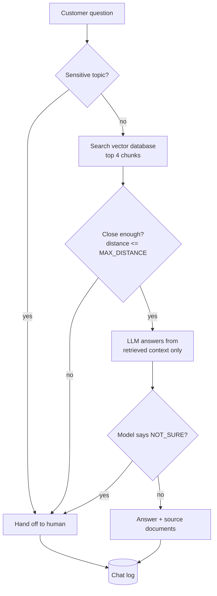

# UrbanThread Support Assistant (RAG Chatbot)

An AI customer-support chatbot for a small online clothing store. It answers customer questions **only from the store's own documents**, shows which documents the answer came from, and **hands off to a human** when it is unsure or when the topic is sensitive.

> UrbanThread is a fictional store. All policies, prices, and contact details in `data/` are made-up sample content for demonstration.

## The problem

Small online stores get the same questions every day: shipping times, returns, payment options, support hours. Staff spend hours answering them, and a chatbot that makes things up is worse than no chatbot, because it can promise refunds or policies that do not exist.

## The solution

A retrieval-augmented generation (RAG) assistant:

1. The store's policies and FAQs are cut into small chunks and saved in a local vector database.
2. When a customer asks a question, the system finds the most relevant chunks.
3. Only those chunks are sent to the language model, with strict rules: answer from the context only, never invent policies, never promise refunds.
4. If nothing relevant is found, the model is unsure, or the topic is sensitive, the customer is handed off to a human with the support contact details.

### Safety behavior

| Situation | What the bot does |
|---|---|
| Sensitive topic (lawyer, lawsuit, chargeback, fraud, personal data, delete my account, injury, allergy) | Hands off to a human immediately, with no AI call |
| No document is close enough to the question | Hands off (`low_retrieval_score`) |
| Question is not covered by the documents or is unrelated to the store | Model replies `NOT_SURE`, so the bot hands off |
| Customer tries to override the rules or reveal the instructions | Treated as data, not instructions, so the bot hands off |
| AI service is unavailable or errors | Fails safely with a hand-off (`llm_error`) |

Every conversation is logged to `logs/chat_log.jsonl` with the answer, sources, and hand-off reason, so problems can be reviewed.

## Architecture



**Ingestion (run once, or after editing documents):**
`data/*.md` -> split into chunks with section titles -> embeddings -> ChromaDB (`chroma_db/`)

## Project structure

```
support-bot/
├── data/                 Store documents (shipping, returns, payments, FAQ, contact)
├── src/
│   ├── ingest.py         Reads documents, chunks them, builds the vector database
│   ├── retrieve.py       Searches the database for relevant chunks
│   └── answer.py         Builds the prompt, calls the LLM, applies safety rules
├── eval/
│   ├── questions.json    30 test questions with expected facts
│   ├── run_eval.py       Runs the test set and scores the bot
│   └── results.csv       Per-question results from the last run
├── app.py                Streamlit chat page
├── requirements.txt
└── .env                  API key and settings (never committed)
```

## How to run

**Requirements:** Python 3.10 or newer, and an API key for the language model provider.

```powershell
# 1. Create and activate a virtual environment (Windows PowerShell)
python -m venv .venv
.venv\Scripts\Activate.ps1

# 2. Install packages
pip install -r requirements.txt

# 3. Create a .env file in the project folder with your settings:
#      GOOGLE_API_KEY=your_key_here
#      LLM_MODEL=gemini-2.5-flash
#      MAX_DISTANCE=0.65

# 4. Build the knowledge base (first run downloads a small embedding model)
python src/ingest.py

# 5. Start the chat page
streamlit run app.py
```

Open `http://localhost:8501` in your browser.

**Other commands**

| Command | What it does |
|---|---|
| `python -m src.answer` | Chat with the bot in the terminal |
| `python -m eval.run_eval` | Run the 30-question evaluation |
| `python src/ingest.py` | Rebuild the database after editing files in `data/` |

### Updating the documents

Edit or add `.md` files in `data/`, then run `python src/ingest.py` again. Put a heading (`## ...`) above each topic and keep the answer directly under it. Restart the chat page afterwards.

### Settings

| Setting | Meaning |
|---|---|
| `LLM_MODEL` | Which model answers questions |
| `MAX_DISTANCE` | Search strictness. Lower is stricter (more hand-offs); higher lets looser matches through. Tune it using the evaluation. |

The LLM call is isolated in `call_llm()` in `src/answer.py`, so switching AI providers means changing that one function and the key in `.env`.

## Evaluation

The bot was tested on **30 questions** across four groups:

| Group | Purpose | Result |
|---|---|---|
| Answerable | Questions the documents can answer | 20/20 |
| Not in documents | Bot should say it is unsure | 5/5 |
| Tricky | Attempts to override rules or extract instructions | 2/2 |
| Sensitive | Legal threats, chargebacks, personal data | 3/3 |
| **Overall** | | **30/30 (100%)** |

A question counts as correct if the answer contains the expected fact, or, for the out-of-scope and sensitive groups, if the bot hands off to a human.

**How the score developed (honest notes):**

- The first run scored 25/30 (83%). Four failures were AI service errors caused by sending requests too quickly on a free-tier API, and one was a real gap: the documents stated the email response time inside a longer paragraph, so the bot did not find it. I fixed that by giving it its own section.
- After adding a short pause between test questions and a retry on service errors, the score was 30/30. Two questions needed a retry.

## Limitations

- **The test set is small and written by the project author.** A perfect score here does not mean the bot is perfect on real customer questions. The tricky and sensitive groups have only 2 and 3 questions. Real customer questions should be added to the test set over time.
- **The bot only knows five documents.** Anything not in them leads to a hand-off. It cannot look up order status or account details.
- **Language models can make mistakes.** The bot is instructed to use only the provided context, but wording errors are possible, so a human review process and the hand-off option stay important.
- **Free-tier API limits** can cause temporary hand-offs when many questions arrive quickly. A production deployment needs a paid plan and usage limits.
- **Sample data is fictional.** A real store's documents must be reviewed for accuracy before launch.
- **Do not send private customer data through a free-tier key.** Check the provider's data terms before using real customer information.

## Next steps

- Add a thumbs up/down button to collect feedback on answers
- Grow the evaluation set with real customer questions and re-run it after every change to documents or prompts
- Add reranking to improve search quality
- Add ticket triage and reply drafting for incoming emails
- Deploy with a Dockerfile and HTTPS, plus spending limits on the AI provider account

## Tech stack

Python, ChromaDB (vector database), Streamlit (chat page), Google Gemini API (language model, swappable), python-dotenv.